<!-- Custom artwork is stored in profile-assets/. Keep this folder next to README.md. -->

  <picture>
    <source media="(max-width: 600px)" srcset="./profile-assets/banner-mobile.svg" />
    
  </picture>

  
  
  

  <strong>Seeking Data Scientist &amp; Data Analyst opportunities</strong>

<h2></h2>

I'm a final-year Bachelor of Computer Science student at **Universiti Tunku Abdul Rahman (UTAR), Kampar campus**. I enjoy working with Python and exploring how data and software can solve everyday problems.

- 🔎 **Interests:** Data science, computer vision, AI, and backend development
- 🎮 **Side quests:** Game development and 3D modelling with Blender
- 🗣️ **Languages:** English, Bahasa Malaysia, and Mandarin

<h2></h2>

<table>
  <tr>
    <td width="50%" valign="top">
      
      <h3><a href="https://github.com/CasperNg-2004/Crawlee_Testing">Google Maps Café &amp; Drinks Data Pipeline ↗</a></h3>
      
Collects café data, classifies photos with CLIP, extracts menu text with PaddleOCR, and compares photographed menus with typed menus. Exports JSON, CSV, and Excel reports.

      
<code>Python</code> <code>JavaScript</code> <code>Crawlee</code> <code>Playwright</code> <code>CLIP</code> <code>PaddleOCR</code>

    </td>
    <td width="50%" valign="top">
      
      <h3><a href="https://github.com/CasperNg-2004/Games">Turn-Based Battle Game ↗</a></h3>
      
A Python turn-based battle game exploring game logic and interactive gameplay.

      
<code>Python</code> <code>Game logic</code>

    </td>
  </tr>
  <tr>
    <td width="50%" valign="top">
      
      <h3><a href="https://github.com/CasperNg-2004/Food-Saver-App">PantryPal — Food Saver App ↗</a></h3>
      
An offline-first Android pantry manager built by Group 12. Tracks ingredients and expiry dates, provides expiry alerts, and suggests recipes using available ingredients. Stores data locally.

      
<code>Kotlin</code> <code>Java</code> <code>Android</code> <code>WorkManager</code>

    </td>
    <td width="50%" valign="top">
      
      <h3><a href="https://github.com/CasperNg-2004/Flight-Ticket-Management-System">Flight Ticket Management System ↗</a></h3>
      
A Windows console application for flight booking, booking amendments, simulated payments, passenger check-in, and invoices, with local JSON storage.

      
<code>C++20</code> <code>MSVC</code> <code>JSON</code>

    </td>
  </tr>
</table>

<h2></h2>

  

| Category | Technologies |
| --- | --- |
| Languages | Python, JavaScript, Kotlin, Java, C++ |
| Backend & Data | FastAPI, Supabase |
| Development Tools | Git, Docker, VS Code |
| Creative Tools | Blender |

**Other interests:** Databases · Cloud computing · 3D modelling

<h2></h2>

- **Computer vision:** Traffic sign recognition
- **Machine learning:** Regression, classification, and cross-validation
- **Algorithms:** Complexity analysis and problem solving

<h2></h2>

I'm happy to connect about data science and analytics opportunities, Python, or the projects above.

- **LinkedIn:** [Ng Yin Hern](https://www.linkedin.com/in/ng-yin-hern-02b629391/)
- **Email:** [ngyinhern@gmail.com](mailto:ngyinhern@gmail.com)
- **GitHub:** [@CasperNg-2004](https://github.com/CasperNg-2004)

<h2></h2>

  

Code, data, and one more side quest.

